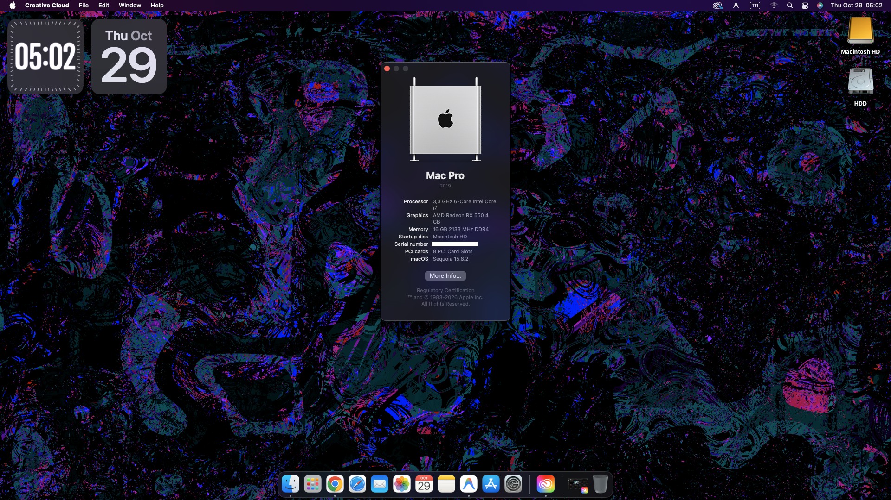

# MSI X99A Gaming Pro Carbon (`MS-7A20`) — macOS 15 Sequoia OpenCore EFI & Modified BIOS


-red)
-0071C5?logo=intel)
%20%7C%20GTX%201660%20Super-ED1C24?logo=amd)

Complete OpenCore EFI configuration, modified `1.40` BIOS (`E7A20IMS.140`), and technical root-cause analysis for running **macOS 15 Sequoia** (and Big Sur / Monterey / Ventura / Sonoma) on the **MSI X99A Gaming Pro Carbon (`MS-7A20`)** motherboard.

---

## 📸 Screenshot



---

## 🖥️ Hardware Specifications

| Component | Model / Details | Device ID / Notes |
| :--- | :--- | :--- |
| **Motherboard** | MSI X99A Gaming Pro Carbon (`MS-7A20`) | Intel C610 / X99 Wellsburg PCH |
| **BIOS Version** | `E7A20IMS.140` (`7A20v14` Modified) | Hidden `HPET = Disabled`, `CFG Lock = Disabled` (see [BIOS section](#-root-cause-1-console-relocated--appleacpicpu-freeze-hidden-bios-hpet-bug)) |
| **CPU** | Intel Core i7-5820K (6C / 12T @ 3.30 GHz) | Haswell-E (`0x0306F2` spoofed as `0x0306C3`) |
| **RAM** | 16 GB DDR4 2133 MHz | Quad-Channel DDR4 |
| **GPU** | AMD Radeon RX 550 4 GB (`Polaris 21` / `Baffin`, 640 Shaders) | `1002:67FF` (`1002:0B04`) — Native Metal acceleration out of the box *(Also tested with NVIDIA GTX 1660 Super)* |
| **Storage (NVMe)** | Patriot P300 256 GB M.2 PCIe Gen3 x4 | `126F:2263` (Silicon Motion SM2263XT) |
| **Storage (SATA)** | Intel X99 6-Port SATA AHCI Controller | `8086:8D02` |
| **Ethernet** | Intel I218-V Gigabit Ethernet | `8086:15A1` (`IntelMausiEthernet.kext`) |
| **Audio** | Realtek ALC1150 + AMD HDMI/DP Audio | `10EC:0900` (`AppleALC.kext`, `layout-id = 1`) |
| **USB Controllers** | Intel X99 XHCI (`8086:8D31`), EHC1/EHC2 (`8086:8D26`/`8D2D`), VIA VL805 (`1106:3483`), ASMedia ASM1142 (`1B21:1242`) | Custom USB port map configured for macOS 15 |
| **SMBIOS** | `MacPro7,1` | macOS Sequoia 15.8.2 |

---

## 🔍 Why This Motherboard Fails to Boot by Default (And How We Solved It)

The **MSI X99A Gaming Pro Carbon (`MS-7A20`)** suffers from two notorious firmware bugs that prevent macOS Big Sur through macOS 15 Sequoia from booting with a standard Dortania / OpCore-Simplify X99 configuration:

1. **Hard freeze right after `console relocated to 0xe0000000` or `AppleACPICPU`** (no kernel panic output, keyboard LEDs frozen, USB activity stops).
2. **Forbidden sign (`#[EB.MM.AKMR]`, `#[EB|STOP] 0x15` / `0x16`, `No slide values are usable`)** during Stage 1 or Stage 2 (`macOS Installer`) boot, or random runtime hangs if `DevirtualiseMmio` is enabled without a whitelist.

Below is the exact technical breakdown and solution for both issues.

---

### 🧩 Root Cause #1: `console relocated` / `AppleACPICPU` Freeze (Hidden BIOS `HPET` Bug)

#### The Problem
On official MSI BIOS versions (`7A20v151` beta and stock `7A20v14`), the kernel locks up completely during early ACPI/PCI initialization (`AppleACPICPU` or immediately after `console relocated to 0xe0000000`). Software ACPI patches (`SSDT-HPET` + `_CRS` to `XCRS` IRQ patches) **do not** prevent this hardware-level interrupt conflict on the `MS-7A20`.

Furthermore, MSI **hid (`Suppressed`) the `HPET` toggle** inside the BIOS Setup GUI and left it `Enabled (0x01)` by default.

#### The Solution: Modified `E7A20IMS.140` BIOS
By binary-diffing the custom [`BIOS/E7A20IMS.140.zip`](./BIOS/E7A20IMS.140.zip) firmware (originally shared by **DSM2** on `hackintosh-forum.de`) against MSI's official `7A20v14` (`E7A20IMS.140`) release using `UEFITool` and `AMIBCP`, we verified that **323 out of 325 UEFI modules are 100% identical** to official MSI firmware. Only the `Setup` (`fe612b72-203c-47b1-8560-a66d946eb371`) and `StdDefaults` NVRAM modules were modified to set 12 NVRAM defaults:

| NVRAM VarStore & Offset | BIOS Setting Name | Stock `7A20v14` | Modified `E7A20IMS.140` | Impact on macOS |
| :--- | :--- | :---: | :---: | :--- |
| **`IntelSetup[0x00F2]`** | **HPET** *(Hidden in BIOS GUI!)* | `0x01` (Enabled) | **`0x00` (Disabled)** | **Fixes `console relocated` / `AppleACPICPU` hard freeze** |
| **`IntelSetup[0x0075]`** | **CFG Lock** (`MSR 0xE2`) | `0x01` (Enabled) | **`0x00` (Disabled)** | Native XCPM power management (`EIST CFG Lock 0`) |
| **`IntelSetup[0x0069]`** | **Intel C-State** | `0x02` (Auto) | **`0x01` (Enabled)** | Proper CPU idle states |
| **`IntelSetup[0x006C]`** | **Package C State Limit** | `0xFF` (Auto) | **`0x02` (C6 Non-Retention)** | Prevents X99 C-state package lockups |
| **`Setup[0x0262]`** | **Above 4G Decoding** | `0x00` (Disabled) | **`0x01` (Enabled)** | 64-bit PCIe BAR allocation |
| **`Setup[0x0248]`** | **Windows 8.1/10 WHQL Support** | `0x00` (Disabled) | **`0x01` (Enabled)** | Pure UEFI mode |
| **`Setup[0x028C]`** | **CSM Support** | `0x01` (Enabled) | **`0x00` (Disabled)** | Disables legacy CSM |
| **`Setup[0x0370]`** | **Boot Mode Select** | `0x02` (Legacy+UEFI) | **`0x01` (UEFI)** | Pure UEFI boot |
| **`OcSetupData[0x008C]`** | **Extreme Memory Profile (XMP)** | `0x00` (Disabled) | **`0x02` (Profile 1)** | Enables DDR4 XMP profile |
| **`SecureBootSetup[0x0001]`**| **Secure Boot Mode** | `0x00` (Standard) | **`0x01` (Custom / Off)** | Disables UEFI Secure Boot |

> [!IMPORTANT]
> **How to Flash:**
> 1. Extract [`BIOS/E7A20IMS.140.zip`](./BIOS/E7A20IMS.140.zip) onto a FAT32 USB flash drive.
> 2. Enter BIOS Setup and use **M-Flash** to flash `E7A20IMS.140`.
> 3. **Do NOT change any BIOS settings after flashing!** Simply boot straight into OpenCore—all required settings (including the hidden `HPET = Disabled` and `CFG Lock = Disabled`) are already pre-applied in `StdDefaults`.

---

### 🧩 Root Cause #2: Stage 2 `macOS Installer` Forbidden Sign (`DevirtualiseMmio` + `MmioWhitelist`)

#### The Problem
- **When `DevirtualiseMmio = false`:** OpenCore reports `OCABC: No slide values are usable! Falling back to 128 with 0x163AD000 bytes!`. While the small Stage 1 Recovery image fits inside the 355 MB (`0x163AD` = `91,053` pages) safe-mode slide allocation at `0x10100000`, **Stage 2 (`macOS Installer`)** requires **`122,215` pages (~477 MB)** and immediately fails with a forbidden sign:
  ```text
  OCABC: No slide values are usable! Falling back to 128 with 0x163AD000 bytes!
  AAPL: #[EB.MM.AKMR|!] Err(0xE) <- EB.M.BAPr2 2 2 122215 0x10100000
  AAPL: #[EB|STOP] 0x15
  AAPL: Displaying boot failure graphic for 10 seconds...
  ```
- **When `DevirtualiseMmio = true` (without `MmioWhitelist`):** OpenCore strips the `EFI_MEMORY_RUNTIME` attribute from **all three** MMIO regions on the board, including the Intel PCH RCBA registers and the 16 MB BIOS flash ROM, which can cause runtime/virtual memory freezes as warned in the Dortania guide.

#### The Solution: Targeted `MmioWhitelist`
Inspecting the OpenCore memory map dump (`@[EB|MMD]`) on the `MS-7A20` reveals 3 runtime `EfiMemoryMappedIO` (`Type 0x0B`) regions:

```text
@[EB|MMD][# 26] 0x0000000B 0x0000000040000000 ... 0x0000000000010000 (256 MB - Blocks KASLR slides!)
@[EB|MMD][# 27] 0x0000000B 0x00000000FED1C000 ... 0x0000000000000029 (164 KB - Intel PCH / RCBA registers)
@[EB|MMD][# 28] 0x0000000B 0x00000000FF000000 ... 0x0000000000001000 (16 MB  - Motherboard BIOS Flash ROM)
```

By enabling `DevirtualiseMmio = true` and whitelisting **`0xFED1C000` (`4275159040`)** and **`0xFF000000` (`4278190080`)** in `Booter -> MmioWhitelist`, OpenCore protects the motherboard's PCH and BIOS ROM runtime mappings (`skip 1`) while freeing the 256 MB block at `0x40000000` (`skip 0`), unlocking 97/256 valid KASLR slides:

```xml
<key>Booter</key>
<dict>
    <key>MmioWhitelist</key>
    <array>
        <dict>
            <key>Address</key>
            <integer>4275159040</integer>
            <key>Comment</key>
            <string>MMIO 0xFED1C000 (0x29 pages, PCH/RCBA)</string>
            <key>Enabled</key>
            <true/>
        </dict>
        <dict>
            <key>Address</key>
            <integer>4278190080</integer>
            <key>Comment</key>
            <string>MMIO 0xFF000000 (0x1000 pages, BIOS ROM)</string>
            <key>Enabled</key>
            <true/>
        </dict>
    </array>
    <key>Quirks</key>
    <dict>
        <key>DevirtualiseMmio</key>
        <true/>
    </dict>
</dict>
```

---

## 📦 Included EFI Folders

This repository provides **two separate, ready-to-use OpenCore 1.0.4 EFI folders** depending on your GPU:

| Folder | Target GPU | Details |
| :--- | :--- | :--- |
| **[`EFI-RX550/EFI`](./EFI-RX550/EFI)** | **AMD Radeon RX 550 4 GB (`Polaris 21` / `Baffin`, 640 Shaders)** | 100% native Metal acceleration out of the box (`1002:67FF`), SIP enabled (`csr-active-config = 00000000`), zero NVIDIA patches/boot-args. |
| **[`EFI-GTX1660Super/EFI`](./EFI-GTX1660Super/EFI)** | **NVIDIA GeForce GTX 1660 Super (`TU116`)** | Pre-configured for [`nullmoth/nvidia-macos-driver`](https://github.com/nullmoth/nvidia-macos-driver) & [`nullmoth/1401`](https://github.com/nullmoth/1401) with `AMFIPass.kext`, `IONDRVSupport` block, and Turing GSP/KMS `boot-args`. |

### Common Components (`OC/ACPI`, `OC/Kexts`, `OC/Drivers`)
- **ACPI (`OC/ACPI`):**
  - `SSDT-EC.aml` — Fake Embedded Controller
  - `SSDT-PLUG.aml` — XCPM CPU Power Management (`PR00`)
  - `SSDT-RTC0-RANGE.aml` — X99 RTC memory range fix
  - `SSDT-SBUS.aml` — System Management Bus
  - `SSDT-UNC.aml` — Disables unused X99 Uncore (`UNC0`) bridges
  - `SSDT-USBX.aml` — USB power properties
- **Kexts (`OC/Kexts`):**
  - `Lilu.kext` (`v1.7.3`) & `WhateverGreen.kext` (`v1.7.2`)
  - `VirtualSMC.kext`, `SMCProcessor.kext`, `SMCSuperIO.kext` (`v1.3.9`)
  - `AppleALC.kext` (`v1.9.9`) — Realtek ALC1150 audio (`layout-id = 1`)
  - `IntelMausiEthernet.kext` (`v3.0.3`) — Intel I218-V Gigabit Ethernet
  - `CpuTscSync.kext` (`v1.1.3`) — X99 TSC synchronization
  - `NVMeFix.kext` (`v1.1.4`) & `RestrictEvents.kext` (`v1.1.7`)
  - `USBToolBox.kext` (`v1.2.0`), `UTBDefault.kext` (`v1.0`), `XHCI-unsupported.kext` (`v0.9.2`)
  - `AMFIPass.kext` (`v1.4.1`) — *(Included in `EFI-GTX1660Super/EFI` only)*
- **Drivers (`OC/Drivers`):**
  - `OpenRuntime.efi`, `HfsPlus.efi`, `ResetNvramEntry.efi`

---

## 🎮 GPU Configuration

### Option A: AMD Radeon RX 550 4GB (`Polaris 21` / `Baffin`, 640 Shaders) — [`EFI-RX550/EFI`](./EFI-RX550/EFI)
Copy the `EFI` folder inside [`EFI-RX550/`](./EFI-RX550/) to your EFI partition. It provides 100% native Metal acceleration in macOS 15 Sequoia with SIP enabled (`csr-active-config = 00000000`) and clean boot arguments:
```text
-v debug=0x100 keepsyms=1 npci=0x2000
```
*(If using an AMD Radeon RX 6600 / RX 6600 XT Navi 23 card with `EFI-RX550/EFI`, simply append `agdpmod=pikera` to `boot-args`.)*

### Option B: NVIDIA Turing / GTX 1660 Super (`TU116`) — [`EFI-GTX1660Super/EFI`](./EFI-GTX1660Super/EFI)
Copy the `EFI` folder inside [`EFI-GTX1660Super/`](./EFI-GTX1660Super/) to your EFI partition. It is pre-configured for **[nullmoth/nvidia-macos-driver](https://github.com/nullmoth/nvidia-macos-driver)** and **[nullmoth/1401](https://github.com/nullmoth/1401)** (`1401.app` will automatically install its `NullMothSafe.efi` helper when setting up the driver):
```text
-v debug=0x100 keepsyms=1 npci=0x2000 nvfb=1 nvaccel=1 nvfbheads=4 -nvkmsnosmooth amfi_get_out_of_my_way=0x1 amfi=0x80 ipc_control_port_options=0 gfxrst=4 nvrmsettle=10000
```

---

## ⚠️ Before You Boot: Generate Your Own SMBIOS Serials

For privacy and iMessage/Apple ID safety, the serial numbers in both [`EFI-RX550/EFI/OC/config.plist`](./EFI-RX550/EFI/OC/config.plist) and [`EFI-GTX1660Super/EFI/OC/config.plist`](./EFI-GTX1660Super/EFI/OC/config.plist) have been replaced with dummy placeholders:
- `PlatformInfo -> Generic -> MLB`: `M0000000000000001`
- `PlatformInfo -> Generic -> SystemSerialNumber`: `W00000000001`
- `PlatformInfo -> Generic -> SystemUUID`: `00000000-0000-0000-0000-000000000000`
- `PlatformInfo -> Generic -> ROM`: `112233000000`

Use [GenSMBIOS](https://github.com/corpnewt/GenSMBIOS) to generate unique **`MacPro7,1`** serials before logging into iCloud.

---

## 🙏 Credits & Acknowledgements

- **[DSM2](https://www.hackintosh-forum.de/forum/thread/57364-msi-x99a-gaming-pro-carbon-ventura/?pageNo=8)** (`hackintosh-forum.de`) — For creating and sharing the modified `E7A20IMS.140` BIOS for the MSI X99A Gaming Pro Carbon.
- **[nullmoth](https://github.com/nullmoth)** — For [`nvidia-macos-driver`](https://github.com/nullmoth/nvidia-macos-driver) and [`1401`](https://github.com/nullmoth/1401), bringing NVIDIA Turing acceleration to modern macOS.
- **[Acidanthera](https://github.com/acidanthera)** — For OpenCorePkg, Lilu, VirtualSMC, WhateverGreen, AppleALC, NVMeFix, and RestrictEvents.
- **[Dortania](https://dortania.github.io/OpenCore-Install-Guide/)** — For the OpenCore Install Guide and X99 / Haswell-E documentation.
